<div align="center">

# CV Genie

**A fast, private, minimalist CV builder — 18 templates including Europass, a matching cover letter builder with Gemini AI writing, a 7-category ATS engine with job-description matching and an optional Gemini AI coach, profile photos, and PDF / DOCX / RTF / Markdown / TXT export.**

[](https://github.com/touhidsiddiqueeraj-bit/CV-Genie/actions/workflows/ci.yml)
[](https://github.com/touhidsiddiqueeraj-bit/CV-Genie/actions/workflows/deploy.yml)
[](https://github.com/touhidsiddiqueeraj-bit/CV-Genie/actions/workflows/release.yml)

[Live demo](https://touhidsiddiqueeraj-bit.github.io/CV-Genie/) · [Templates](#-templates) · [What's new](#-whats-new-in-v22) · [Documentation](#-documentation)

</div>

---

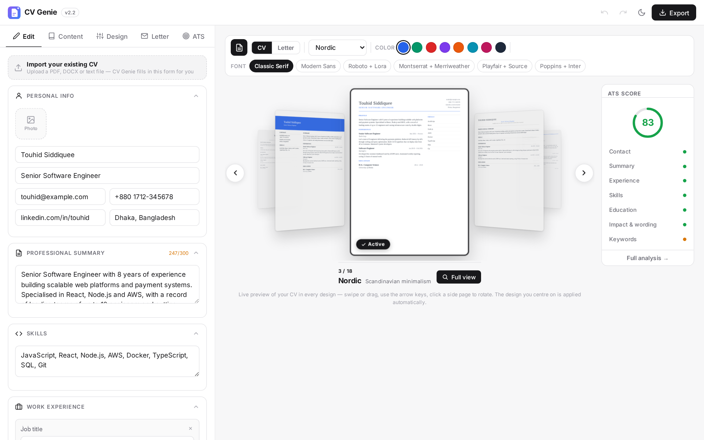

## ✦ Why CV Genie

- **Private by default** — everything runs in your browser. No accounts, no tracking, no data leaves your device (unless you explicitly use the optional server-rendered exports).
- **No paywall at the download button** — every template, every export format, the cover letter, the matcher: free, forever. Most builders let you build for free, then charge $25/month to export.
- **Zero friction** — no build step, no dependencies to install. One HTML file, open it and go.
- **ATS-aware** — a 7-category engine with ~25 concrete checks (plus job-description matching and an optional Gemini AI coach) scores your CV on every keystroke and shows exactly what to fix.
- **Serious output** — high-quality PDF, editable DOCX and RTF, plus bulk export of all 18 templates in one ZIP.
- **Works everywhere** — responsive down to phone screens, dark mode, offline-capable (PWA service worker).

## ✦ What's new in v2.2

| Area | Change |
|---|---|
| **ATS engine v2** | The analyser is now a proper 7-category engine — contact, summary, experience, skills, education, impact & wording, and keywords — built from ~25 individual checks (action verbs, quantified achievements, duty phrasing, buzzwords, bullet length, date consistency, first person, recency…), each with a concrete fix. Weighted scoring, a letter grade, per-category bars and a prioritised *fix-these-first* list replace the old keyword-coverage number. |
| **AI Coach** | An optional Gemini review layered on top of the local report: verdict, quick wins, a rewritten summary, up to four rewritten bullets and suggested keywords — each with a one-click **Apply** button that edits the form in place. Uses your own free API key (same key as CV import), stored only in your browser. |
| **Job match integration** | The job-description matcher now feeds the engine — pasting a posting swaps the keyword category for a **Job match** category, and the sidebar widget, checks and score all update together. |
| **Bug fixes** | The *Add all missing keywords* button produced a broken `onclick` (quotes inside a double-quoted attribute) and never worked — rewritten with a data attribute. The JD *Clear* button also referenced a non-existent `saveState()`. |

## ✦ What's new in v2.1

| Area | Change |
|---|---|
| **Cover letter builder** | A full letter editor with a one-click draft generated from your CV, or full AI writing via Gemini (your own key): four tailored paragraphs in your chosen tone, grounded strictly in your CV and the pasted job description. The letter shares your CV's accent colour and fonts, so the pair reads as a matching set. Export as PDF (server or instant), RTF, Markdown or plain text. |
| **Job description match** | Paste a real posting and CV Genie extracts its keywords (multi-word phrases included), scores your CV against them, and shows exactly what's missing — click any missing keyword to add it, or add all missing at once. |
| **"What the ATS sees"** | An honest plain-text extraction of your CV in parse order, plus parse checks (email/phone detection, word count, sections, dates). See what a parser gets, not what a marketing score claims. |
| **Markdown & TXT export** | For GitHub profiles, web posting and online forms — works for both CV and cover letter. |

## ✦ What's new in v2.0

| Area | Change |
|---|---|
| **UI** | Complete minimalist redesign — neutral palette, hairline borders, stroke icons, clean type scale, calmer animations. The app chrome gets out of the way of your content. |
| **Europass CV** | New official-style Europass template — a faithful reproduction of the European Commission's official DOCX (logo header, right-aligned label gutter, blue heading rules, CEFR self-assessment grid, © European Union footer). |
| **4 more templates** | **Nordic** (Scandinavian minimalism), **Swiss** (International Typographic Style), **Academic** (conservative serif) and **Compact** (dense one-pager) — 18 templates in total. |
| **Profile photos** | Photo shape (circle / rounded / square), photo size (S / M / L), one-tap remove, and a cleaner crop-and-rotate editor. Photos now render in *every* template. |
| **Languages** | New Languages section with Native / A1–C2 levels. Feeds the Europass CEFR grid and renders as a styled list in other templates. Also picked up from LinkedIn imports. |
| **Content** | 20 summary templates (was 15) and 10 skill categories (added Legal and Science & Research). |
| **Bug fix** | Restoring state (undo/redo, versions, share links, JSON import) previously dropped the person's name — fixed. |
| **CI/CD** | GitHub Actions for validation, Pages deployment and releases (see [CI/CD](#-cicd)). |
| **Docs** | This README, with screenshots of every template. |

---

## ✦ Features

### Live editor with instant preview

Every keystroke updates the A4 preview (debounced 200 ms). Sections are collapsible and reorderable by drag-and-drop; experience, education and language entries are drag-reorderable too.

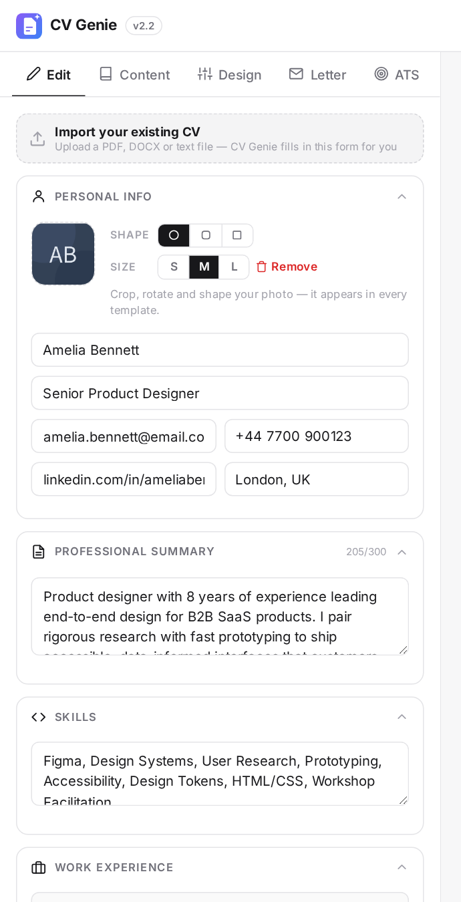

### Profile photos

Upload a picture, crop and rotate it in-browser (Cropper.js), then choose its **shape** — circle, rounded or square — and its **size** (S / M / L). The photo flows into all 18 templates: an ID-style photo in the label gutter on Europass, a framed circle on Modern, a colour-backed circle on Sidebar Bold. Shape and size controls update every template instantly, and the settings travel with saves, share links and version history.

### ATS analyser

The analyser scores your CV across **seven weighted categories** — contact details, summary, experience, skills, education, impact & wording, and keywords — using ~25 deterministic checks in the spirit of commercial ATS scanners: action-verb openers, quantified achievements, duty phrasing (*"responsible for…"*), buzzwords, bullet length and depth, date presence and consistency, first-person pronouns, recency, summary targeting, education completeness, overall length. Every failed or warned check comes with a one-line fix, the score ring gets a letter grade, and the category bars show exactly where points are lost. Everything runs locally, on every keystroke.

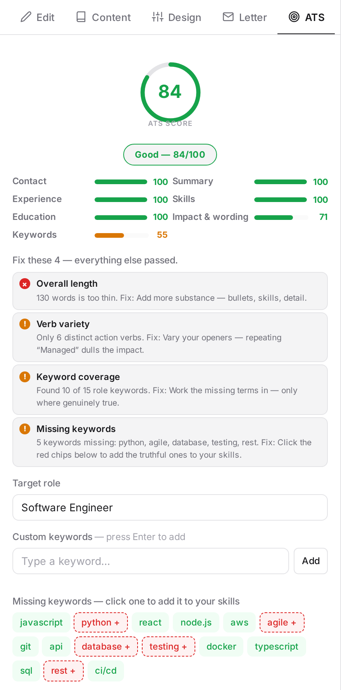

**Keywords.** Type a target role and the engine matches it against a dictionary of 80+ roles and their keywords; add your own custom keywords too. Click any missing keyword to inject it straight into your Skills field. The score and per-category checklist stay pinned next to the preview.

**Job description match.** Dictionaries are generic; postings are not. Paste the actual job description and CV Genie extracts its key terms — favouring multi-word phrases like *design systems* or *stakeholder communication* over noise words — then swaps the keyword category for a **Job match** category: a match score, chips for every posting keyword (found and missing), and one-click *add all missing* as custom keywords. Everything runs locally; the posting never leaves your browser.

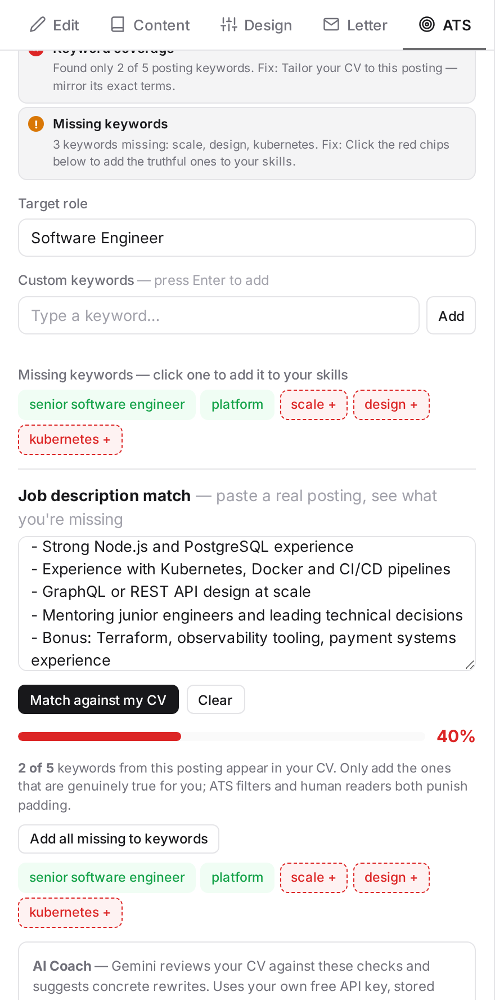

**AI Coach.** Optional, with your own free Gemini API key (the same one as CV import): Gemini reviews your CV — with the local report and the pasted posting as context — and returns a verdict, quick wins, a rewritten summary, up to four rewritten bullets (with the reasoning) and suggested keywords. Every rewrite has an **Apply** button that edits the form in place; unknown metrics come back as `[X%]` placeholders so nothing gets invented. The key is stored only in your browser; the request goes browser → Google directly, and it reuses the import's model fallback chain (`gemini-flash-latest` → `gemini-flash-lite-latest` → `gemini-3.5-flash-lite` → 3.6/3.8 flash → discovered models) with exponential-backoff retries and a patient second pass, so a busy free tier never leaves you stuck. A **Test** button next to the key field sends a tiny probe request and pinpoints key, model or region problems in one click.

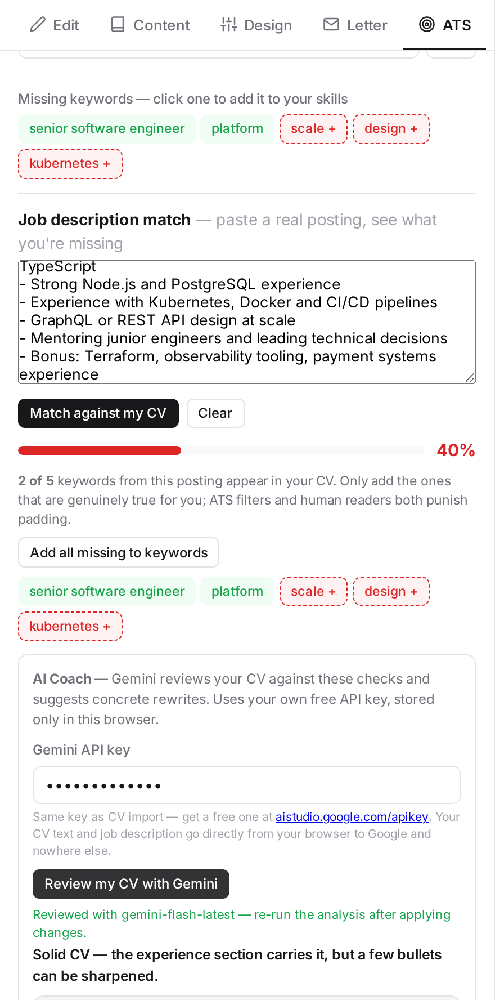

**What the ATS sees.** One click shows the plain text a parser extracts from your CV, in reading order, with parse checks — email and phone detection, word count range, section detection, date references, photo advisory. It's the same content every template produces, because parsing depends on content, not styling — and it's the honest view no builder shows you.

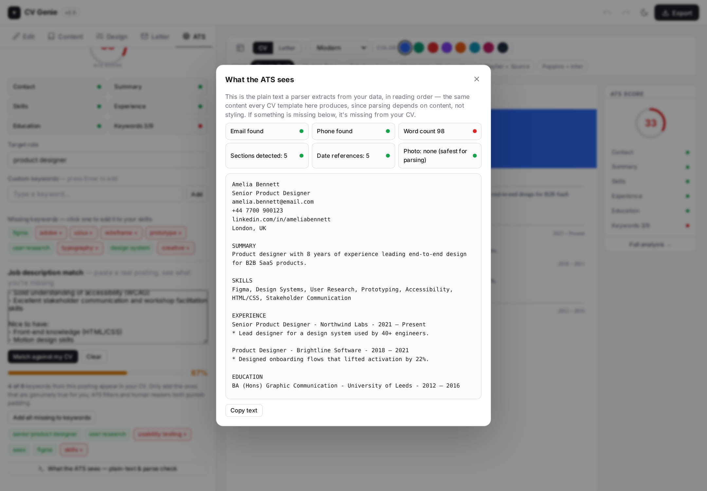

### Cover letter builder

A **Letter** tab beside the editor builds a cover letter that matches your CV — same accent colour, same fonts — from shared contact details. Fill in the company, hiring manager and role, pick a tone (formal / direct / warm), then either:

- **Draft from my CV** — a one-click offline draft from your own experience, skills and most recent role. No AI, no data leaving the browser.
- **Write with Gemini** — the AI writer drafts all four paragraphs (opening, why this company, evidence, closing) from your CV, the target role, your tone choice and the job description you pasted in the ATS tab. It uses only facts from your CV — unknown metrics come back as `[placeholder]` — and reuses the same free API key and model-fallback engine as the ATS coach. The letter lands in the editable fields and the preview switches to it instantly.

Toggle **CV / Letter** above the preview to switch documents; exports (PDF, RTF, Markdown, TXT) follow whichever is active. Letter content travels with saves, share links and version history like everything else.

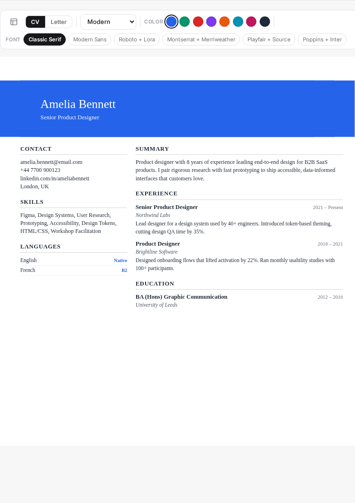

### Template carousel — the default CV view

The CV preview **is** a **cover-flow style 3D carousel** — no gallery to open: your selected design sits large at the centre, the neighbouring designs flank it on both sides at an angle, and two more peek from the edges. Every page is a **live render of your own CV** in that design — not a static wireframe — in your current colour and fonts, updating as you edit. Drag or swipe, use the arrow keys, or click a side page to rotate it to the centre — **the design you centre on is applied automatically** (the counter shows where you are, e.g. *3 / 18*, and the ring wraps around, so you can spin through all 18 designs endlessly). Click the centre page or **Full view** (or the first toolbar button) to zoom into the full-page document view and back. For a quick switch, the toolbar dropdown still works. On mobile, the carousel is the viewpoint behind the floating **Preview** button.


### Design controls

Six font pairings (now properly loaded as web fonts, so exports match the preview) and eight accent colours.

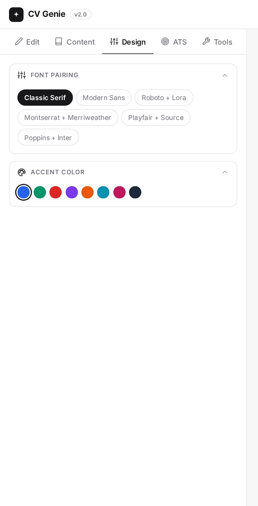

### Export

Pick any combination of high-quality server PDF, instant client PDF, server DOCX, instant RTF, **Markdown** and **plain text** — or export **all 18 templates** in one ZIP. The export dialog follows the active document: cover letters export as PDF / RTF / Markdown / TXT.


### Mobile & dark mode

A dedicated mobile layout with edit/preview navigation, and a full dark theme (auto-detected from your OS, manually toggleable).

| Mobile — edit | Mobile — preview | Dark mode |
|:---:|:---:|:---:|
|  | 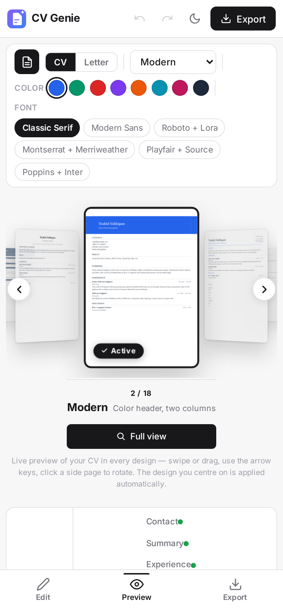 |  |

### Import your existing CV

Upload an old CV in **PDF, DOCX or plain text** (or paste its text) and CV Genie fills in the whole form — personal details, summary, work experience, education, skills and languages.

**How it works, in order of preference:**

1. **Local rule-based parser (default, fully offline).** Text is extracted in your browser — pdf.js for PDFs, JSZip for DOCX — and mapped onto the app's data model. For PDFs the extractor is **coordinate-aware**: text items are clustered into visual lines by position and font size, and large horizontal gaps are kept as column separators, so right-aligned date columns, multi-column skill grids, label/value contact grids and letter-spaced headers (`E D U C A T I O N`) all survive extraction in reading order — the name is picked up as the largest font in the page-1 header area. On top of that: section segmentation (plain and letter-spaced headers), label/value contact pairs plus regex fallbacks, experience/education entries anchored on date ranges with role/company splitting across the common layouts, volunteering mapped into experience, skill-list splitting and CEFR language-level mapping. Every parse gets a **confidence score (0–100)**; the review screen shows exactly what was found, per-section checkboxes to untick anything you don't want, and a heads-up list of anything missing.
2. **Optional Gemini AI fallback.** When the layout is unusual, the CV isn't in English, or the parse just misses things, you can paste **your own free Google AI Studio API key** and let Gemini re-extract the CV with a strict JSON response schema. The key is stored only in your browser's `localStorage` and used for direct browser → Google calls; CV-Genie has no server-side AI. For PDFs the original file is sent as inline data alongside the pre-extracted text, so scanned PDFs need no separate OCR step. Models are **discovered at runtime** from your key's `/models` list — the picker defaults to `gemini-flash-latest`, and if a model is busy (429/500/503) or discontinued the app auto-retries with exponential backoff and falls back (`gemini-flash-lite-latest` → `gemini-3.5-flash-lite` → 3.6/3.8 flash → other available models), so it never gets stuck on one endpoint. AI results are merged with the parser's (parser values fill any gaps) and shown in the same review screen with an "AI" badge.

Importing pushes an undo snapshot first (Ctrl+Z restores your previous CV) and asks before overwriting existing content.

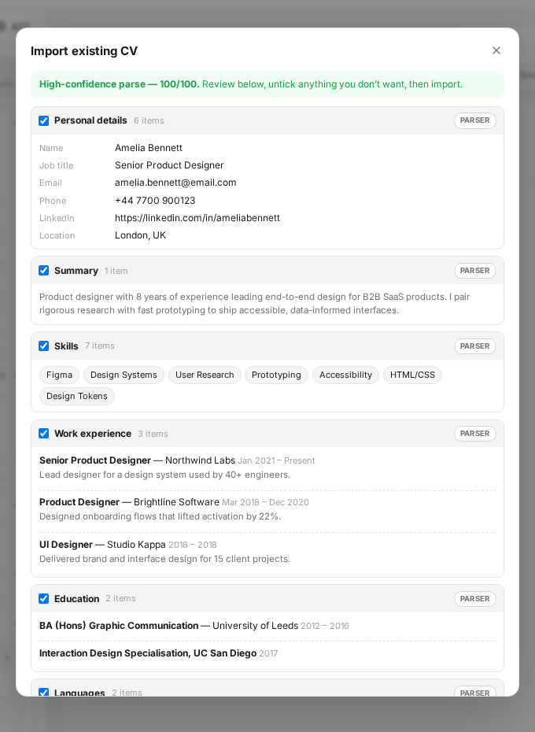

### Data portability

- **CV import** — upload any PDF/DOCX/text CV and autofill the form (local parser, optional Gemini AI with your own key — see above).
- **LinkedIn import** — upload your LinkedIn "Save to PDF" export and autofill the form (experiences, education, skills and languages).
- **Share links** — the entire CV is LZ-compressed into a URL. Anyone with the link sees your exact CV; nothing is sent to a server.
- **JSON backup** — full export/import of your state.
- **Version history** — save and restore up to 10 named snapshots.
- **Autosave** — state persists to `localStorage` every 5 minutes and when the tab is hidden.

---

## ✦ Templates

All 18 templates rendered with the same sample data:

| | | |
|:---:|:---:|:---:|
| [](docs/images/templates/classic.png) | [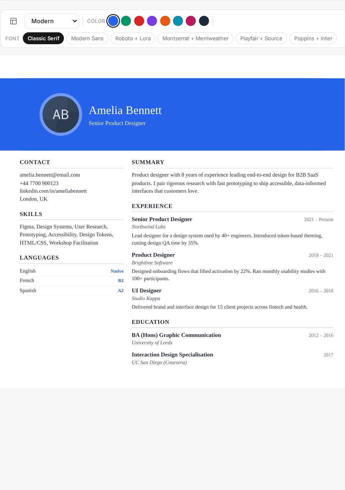](docs/images/templates/modern.png) | [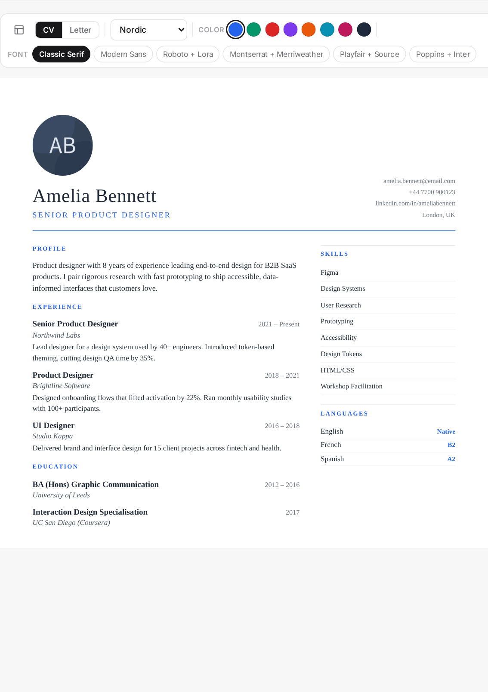](docs/images/templates/nordic.png) |
| **Classic** — traditional serif | **Modern** — colour header, two columns | **Nordic** — Scandinavian minimalism |
| [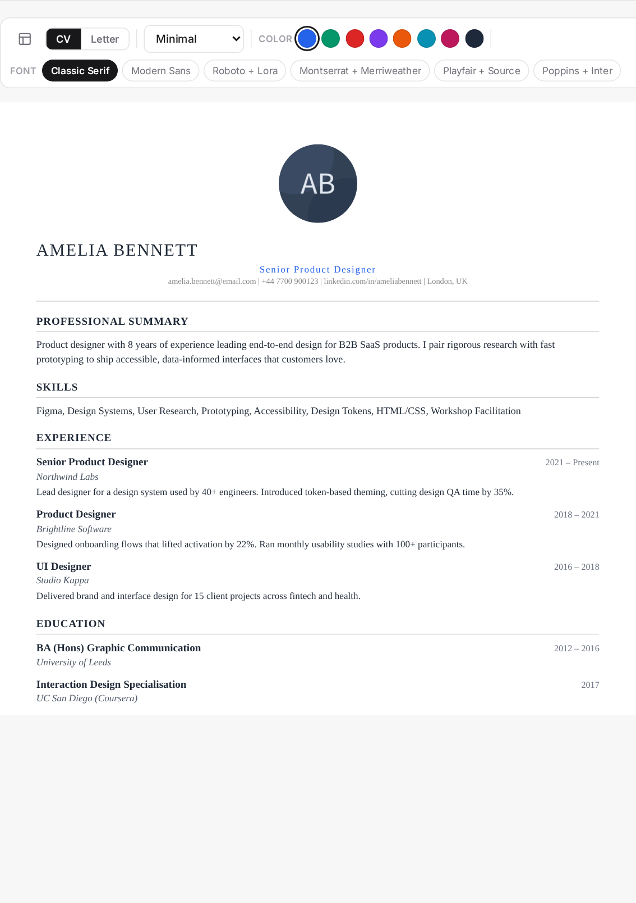](docs/images/templates/minimal.png) | [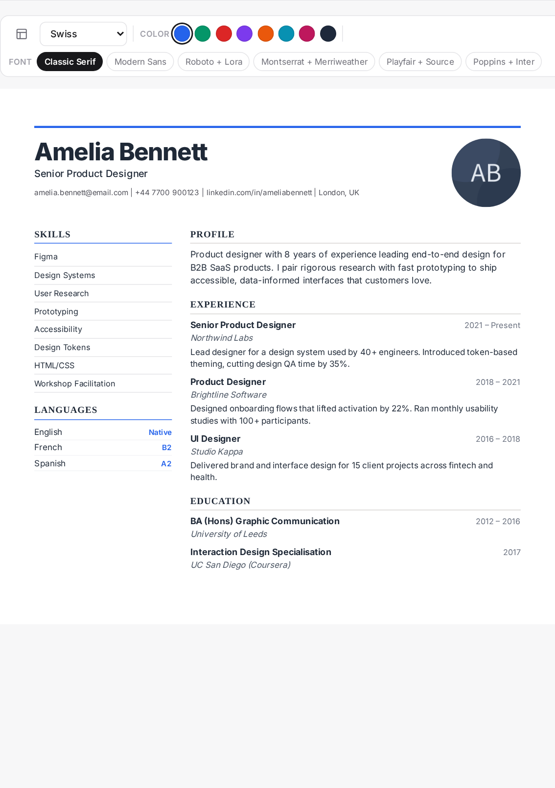](docs/images/templates/swiss.png) | [](docs/images/templates/executive.png) |
| **Minimal** — light and elegant | **Swiss** — typographic grid | **Executive** — boardroom small-caps |
| [](docs/images/templates/academic.png) | [](docs/images/templates/europass.png) | [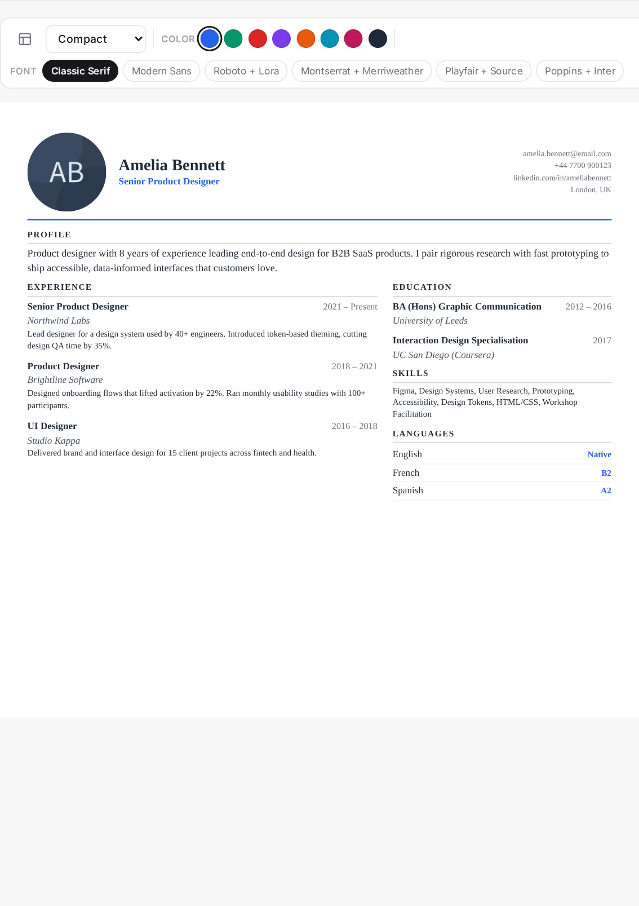](docs/images/templates/compact.png) |
| **Academic** — conservative, centred | **Europass** — EU format with CEFR grid | **Compact** — dense one-pager |
| [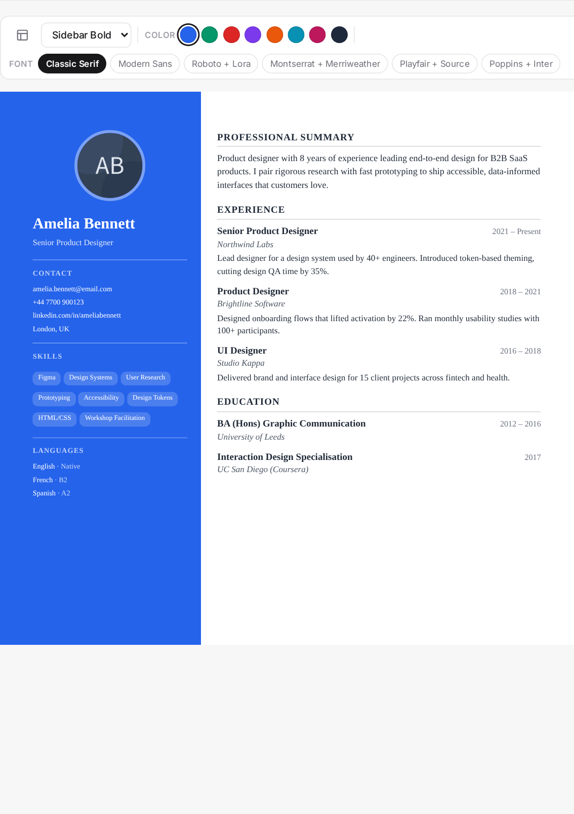](docs/images/templates/sidebar-bold.png) | [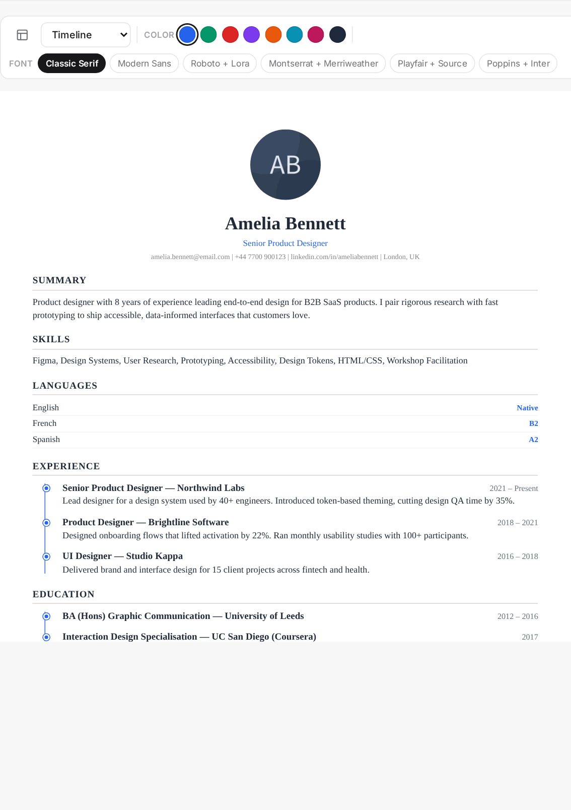](docs/images/templates/timeline.png) | [](docs/images/templates/tabular.png) |
| **Sidebar Bold** — full-colour sidebar | **Timeline** — visual career timeline | **Tabular** — structured tables |
| [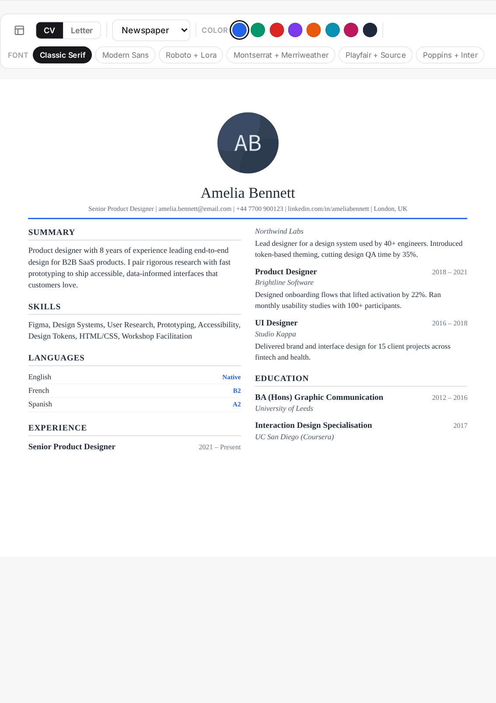](docs/images/templates/newspaper.png) | [](docs/images/templates/magazine.png) | [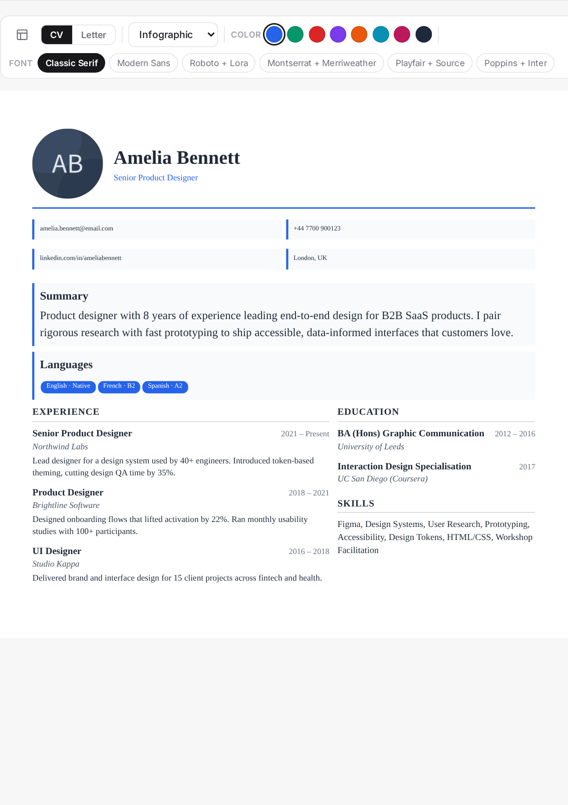](docs/images/templates/infographic.png) |
| **Newspaper** — two-column density | **Magazine** — editorial masthead | **Infographic** — data cards |
| [](docs/images/templates/creative.png) | [](docs/images/templates/colorful.png) | [](docs/images/templates/corporate.png) |
| **Creative** — tag-based skills | **Colorful** — bold gradient | **Corporate** — navy frame |

### About the Europass template

The [Europass CV](https://europa.eu/europass/en) is the European Union's standard CV format. CV Genie's Europass template is a faithful reproduction of the [official European Commission template](https://www.eeas.europa.eu/sites/default/files/standard_cv.docx) — structure, colours and typography were extracted directly from the official DOCX:

- **Header**: the official Europass logo, "Curriculum Vitae" and the candidate name in light blue, exactly like the original first-page header.
- **Personal information**: the name in the content column with contact lines (address, telephone, e-mail, website) and small blue pictograms; the profile photo sits in the label gutter, as in the official layout.
- **Job applied for; position; preferred job; studies applied for; personal statement** — the official stacked label block, filled with your job title and professional summary.
- **Work experience / Education and training** entries with dates right-aligned in the label gutter, position and qualification headings in navy, employers/institutions and square-bulleted activities in the content column.
- **Personal skills** with *Mother tongue(s)*, the official CEFR self-assessment grid (Understanding → Listening / Reading, Speaking → Spoken interaction / Spoken production, Writing) and its levels legend. Your skills are routed automatically into the official sub-labels — *Communication skills*, *Organisational / managerial skills*, *Job-related skills* and *Digital competence* (the section the EU added in its 2015 template revision).
- Official styling tokens: Arial, navy `#0E4194` caps headings with the `#2E90CB` rules, `#1593CB` field labels, `#C0C0C0` grid borders, and the "© European Union" footer. The footer reads *© European Union, 2002-2015 \| europass.cedefop.europa.eu* — that copyright range is the EU's own notice on the current official template (last revised 2015), so it is verbatim, not an outdated copy.

| Understanding | | Speaking | | Writing |
|---|---|---|---|---|
| Listening | Reading | Spoken interaction | Spoken production | |
| B2 | B2 | B2 | B2 | B2 |

Add languages in the **Languages** section of the Edit tab, choosing *Native* for your mother tongue(s) or a CEFR level (A1–C2) for others. The grid fills each skill column with the chosen level — edit the source if you need per-skill levels.

---

## ✦ Documentation

### Getting started

No build step. Either open `index.html` directly, or serve the folder (recommended, so the service worker and CDN fonts behave consistently):

```bash
# any static server works
python3 -m http.server 8080
# or
npx serve .
```

Then open http://localhost:8080. To publish your own copy, push to a GitHub repo and enable GitHub Pages — the included [deploy workflow](.github/workflows/deploy.yml) handles it automatically.

### Architecture

The application is a single, self-contained HTML file (SPA) — vanilla JavaScript, CSS and carefully chosen libraries loaded from CDN. There is no framework and no build step.

**Frontend libraries**

| Library | Purpose |
|---|---|
| html2pdf.js / html2canvas | Client-side PDF and PNG rendering |
| SortableJS | Drag-and-drop reordering (sections and list items) |
| JSZip + FileSaver.js | Bulk ZIP export of all templates |
| pdf.js | Text extraction from LinkedIn PDF uploads |
| Cropper.js | In-browser photo cropping and rotation |
| LZ-String | Compressing CV state into shareable URLs |

**Optional export microservice** — a companion Node.js server (`/export-pdf`, `/export-docx`) renders high-quality files with headless Chrome and the `docx` library. The client falls back to browser-based exports when it is unavailable. See [API endpoints](#api-endpoints-server-side) for the contract.

**Project structure**

```
.
├── index.html                  # the entire app (UI + CSS + JS)
├── docs/images/                # screenshots used by this README
│   └── templates/*.png         # all 18 template previews
├── scripts/
│   └── validate.js             # CI validation (structure, JS syntax, registry, assets)
└── .github/workflows/
    ├── ci.yml                  # validation on push/PR
    ├── deploy.yml              # GitHub Pages deployment
    └── release.yml             # tagged releases with packaged artifact
```

### Smart tabs

| Tab | Contents |
|---|---|
| **Edit** | Personal info (photo, contact), Summary, Skills, Experience, Education, Languages — all collapsible and reorderable |
| **Content** | 20 summary templates · skill cloud (10 categories) |
| **Design** | Font pairing (6) · accent colour (8 presets) · 3D template carousel (live-rendered pages) |
| **Letter** | Company / hiring manager / role / tone · offline one-click draft · **Gemini AI writer** (own key) · four editable paragraphs |
| **ATS** | Score ring + letter grade · 7-category breakdown · ~25 checks with fixes · target role & custom keywords · keyword cloud · job-description match · AI Coach (Gemini, own key) |
| **Tools** | LinkedIn import · JSON backup · share link · version history |

### State management & undo/redo

The whole CV is serialised by `getState()` into one plain object (template, colour, font pair, photo settings, section order, fields, experiences, education, languages, ATS keywords). Undo/redo stacks keep up to 50 snapshots; `restoreState()` rebuilds the form and preview from any snapshot. The same object powers share links, JSON backup, version history and autosave (`localStorage`, key `cvGenie_v2.0`, with migration from the v1 key).

### API endpoints (server-side)

`POST /export-pdf`

```json
{
  "html": "<div class=\"cv-preview cv-modern\">…</div>",
  "color": "#2563eb",
  "fontHeading": "Georgia, serif",
  "fontBody": "Georgia, serif"
}
```

Response: `application/pdf` binary.

`POST /export-docx`

```json
{
  "name": "John Doe",
  "title": "Software Engineer",
  "contact": "john@example.com | …",
  "summary": "…",
  "skills": "…",
  "experiences": [{ "title": "…", "company": "…", "dates": "…", "description": "…" }],
  "education": [{ "degree": "…", "institution": "…", "year": "…" }],
  "languages": [{ "language": "English", "level": "Native" }]
}
```

Response: `application/vnd.openxmlformats-officedocument.wordprocessingml.document` binary.

Both endpoints should handle CORS and return `{ "error": "message" }` JSON on failure.

### Keyboard shortcuts & accessibility

- `Ctrl/Cmd+Z` — undo · `Ctrl/Cmd+Y` — redo (outside text fields)
- `Ctrl/Cmd+S` — suppressed (prevents the browser save dialog)
- Section headers are clickable/focusable; icon buttons carry `aria-label`s; focus-visible rings throughout; dark mode honours `prefers-color-scheme` on first visit.

### PWA

A minimal service worker (registered from a blob URL, cache `cvgenie-v2`) caches the app shell for offline use with a cache-first strategy.

## ✦ CI/CD

Three GitHub Actions workflows:

| Workflow | Trigger | What it does |
|---|---|---|
| [ci.yml](.github/workflows/ci.yml) | push to `main`, PRs | Runs `scripts/validate.js`: HTML structure, tag balance, `node --check` on every inline script, template registry consistency (TEMPLATES ↔ TEMPLATE_META ↔ THUMB_WIRES ↔ switch cases), README image references, workflow YAML parsing, file-size guard |
| [deploy.yml](.github/workflows/deploy.yml) | push to `main`, manual | Deploys the repo to GitHub Pages (upload artifact → deploy-pages). Enable "GitHub Actions" as the Pages source in repo settings |
| [release.yml](.github/workflows/release.yml) | `v*` tags | Validates, packages `index.html` into a versioned ZIP (+ SHA-256) and publishes a GitHub Release with generated notes |

## ✦ Common maintenance tasks

### Adding a new CV template

1. Add the slug to the `TEMPLATES` array (keep `TEMPLATE_META`, `THUMB_WIRES` and the switch in sync — CI checks this).
2. Add `{name, desc}` to `TEMPLATE_META` and a wireframe to `THUMB_WIRES` (tiny div-based layout sketch — shown as the carousel card's fallback if the live render fails).
3. Add a `case 'slug':` to the switch in `templateHtml(t, D)` (built on the data from `collectPreviewData()`; shared helpers: `esc()`, `eH`, `dH`, `langLines`, `ph`, `skillList`, `contactLines`). The main preview and every 3D carousel card render through this one function, so the new design appears in the gallery automatically.
4. Add any template-specific CSS under `.cv-preview.cv-slug { … }`.

### Adding a font pair

Append `{name, heading, body}` to `FONT_PAIRS` and add the families to the Google Fonts `<link>` in `<head>` so the preview and exports render them.

### Updating ATS keyword roles

Edit the module-level `ROLE_KW` dictionary (just above the ATS engine). Target roles are matched longest-first and case-insensitively; these keywords are only used when no job description is pasted — a pasted posting always wins.

### Testing the CV import parser

`scripts/make-cv-fixtures.py` generates three sample CVs (TXT, DOCX via python-docx, PDF via ReportLab) into `/tmp/cvfix`; `scripts/test-cv-import.js` is a Playwright E2E suite (80 assertions) that runs the real app, imports each fixture through the modal, and checks every parsed field plus the apply-into-editor flow, the no-section-headers fallback, AI response mapping/merging and the guard rails:

```bash
python3 scripts/make-cv-fixtures.py
NODE_PATH="$(npm root -g)" node scripts/test-cv-import.js
```

The Gemini network call itself is intentionally not covered (it needs a real key); its response handling is tested via a canned JSON through `cviMapAi()`.

### Testing the ATS engine

`scripts/test-ats-v2.js` is a second Playwright suite (38 assertions): empty state, weak-vs-strong scoring, category bars and check rendering, role-keyword and job-description modes, chip and bulk keyword adding, and the full AI Coach flow with the Gemini network mocked — including the 503 error path (the button must re-enable and show an error, never spin forever).

```bash
NODE_PATH="$(npm root -g)" node scripts/test-ats-v2.js
```

`scripts/shoot-ats.js` regenerates the three ATS screenshots above the same way.

### Regenerating README screenshots

Serve the repo, then use Playwright against `restoreState()` with sample data and `changeTemplate(t)` — screenshot `#cvScaleOuter` per template into `docs/images/templates/`.

---

<div align="center">

**[Live demo](https://touhidsiddiqueeraj-bit.github.io/CV-Genie/)** · Built with vanilla HTML, CSS and JavaScript.

</div>
