<div align="center">

# CV Genie

**A fast, private, minimalist CV builder — 18 templates including Europass, live ATS analysis, profile photos, and PDF / DOCX / RTF export.**

[](https://github.com/touhidsiddiqueeraj-bit/CV-Genie/actions/workflows/ci.yml)
[](https://github.com/touhidsiddiqueeraj-bit/CV-Genie/actions/workflows/deploy.yml)
[](https://github.com/touhidsiddiqueeraj-bit/CV-Genie/actions/workflows/release.yml)

[Live demo](https://touhidsiddiqueeraj-bit.github.io/CV-Genie/) · [Templates](#-templates) · [What's new](#-whats-new-in-v20) · [Documentation](#-documentation)

</div>

---


## ✦ Why CV Genie

- **Private by default** — everything runs in your browser. No accounts, no tracking, no data leaves your device (unless you explicitly use the optional server-rendered exports).
- **Zero friction** — no build step, no dependencies to install. One HTML file, open it and go.
- **ATS-aware** — a built-in analyser scores your CV against role-specific keyword dictionaries and shows exactly what's missing.
- **Serious output** — high-quality PDF, editable DOCX and RTF, plus bulk export of all 18 templates in one ZIP.
- **Works everywhere** — responsive down to phone screens, dark mode, offline-capable (PWA service worker).

## ✦ What's new in v2.0

| Area | Change |
|---|---|
| **UI** | Complete minimalist redesign — neutral palette, hairline borders, stroke icons, clean type scale, calmer animations. The app chrome gets out of the way of your content. |
| **Europass CV** | New official-style Europass template — a faithful reproduction of the European Commission's official DOCX (logo header, right-aligned label gutter, blue heading rules, CEFR self-assessment grid, © European Union footer). |
| **4 more templates** | **Nordic** (Scandinavian minimalism), **Swiss** (International Typographic Style), **Academic** (conservative serif) and **Compact** (dense one-pager) — 18 templates in total. |
| **Profile photos** | Photo shape (circle / rounded / square), photo size (S / M / L), one-tap remove, and a cleaner crop-and-rotate editor. Photos now render in *every* template. |
| **Languages** | New Languages section with Native / A1–C2 levels. Feeds the Europass CEFR grid and renders as a styled list in other templates. Also picked up from LinkedIn imports. |
| **Content** | 20 summary templates (was 15) and 10 skill categories (added Legal and Science & Research). |
| **Bug fix** | Restoring state (undo/redo, versions, share links, JSON import) previously dropped the person's name — fixed. |
| **CI/CD** | GitHub Actions for validation, Pages deployment and releases (see [CI/CD](#-cicd)). |
| **Docs** | This README, with screenshots of every template. |

---

## ✦ Features

### Live editor with instant preview

Every keystroke updates the A4 preview (debounced 200 ms). Sections are collapsible and reorderable by drag-and-drop; experience, education and language entries are drag-reorderable too.


### Profile photos

Upload a picture, crop and rotate it in-browser (Cropper.js), then choose its **shape** — circle, rounded or square — and its **size** (S / M / L). The photo flows into all 18 templates: an ID-style photo in the label gutter on Europass, a framed circle on Modern, a colour-backed circle on Sidebar Bold. Shape and size controls update every template instantly, and the settings travel with saves, share links and version history.

### ATS analyser

Type a target role and the analyser matches it against a dictionary of 80+ roles and their keywords, then scores your CV live. Click any missing keyword to inject it straight into your Skills field. The score and checklist stay pinned next to the preview.


### Template gallery

Browse all 18 designs with live layout wireframes, or switch instantly from the toolbar dropdown.

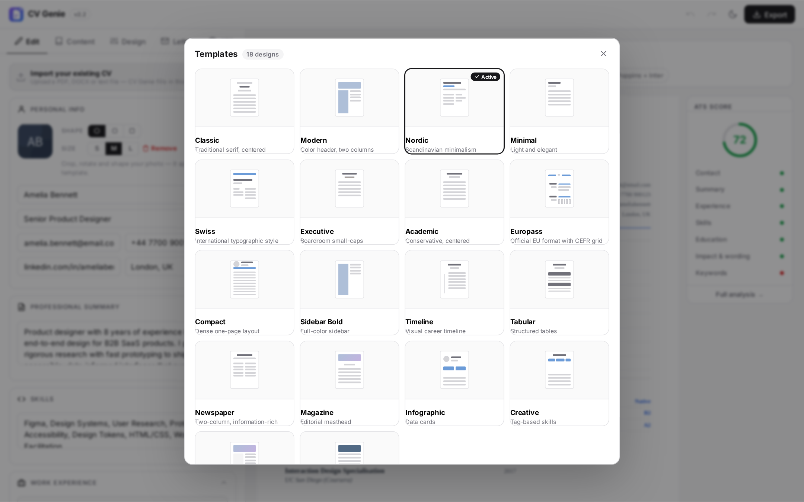

### Design controls

Six font pairings (now properly loaded as web fonts, so exports match the preview) and eight accent colours.


### Export

Pick any combination of high-quality server PDF, instant client PDF, server DOCX and instant RTF — or export **all 18 templates** in one ZIP.

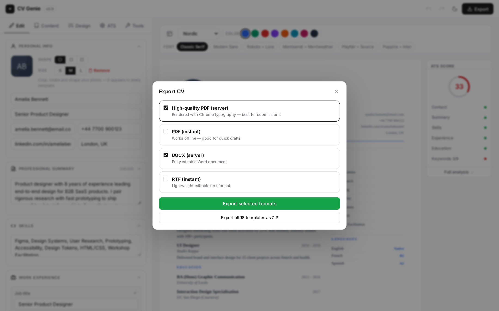

### Mobile & dark mode

A dedicated mobile layout with edit/preview navigation, and a full dark theme (auto-detected from your OS, manually toggleable).

| Mobile — edit | Mobile — preview | Dark mode |
|:---:|:---:|:---:|
| 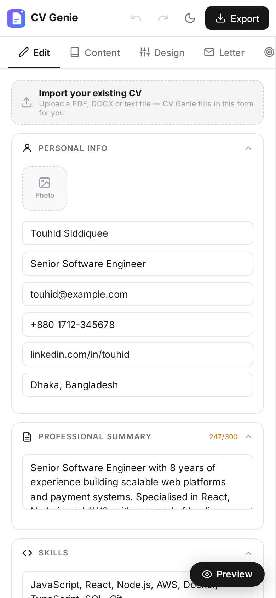 |  | 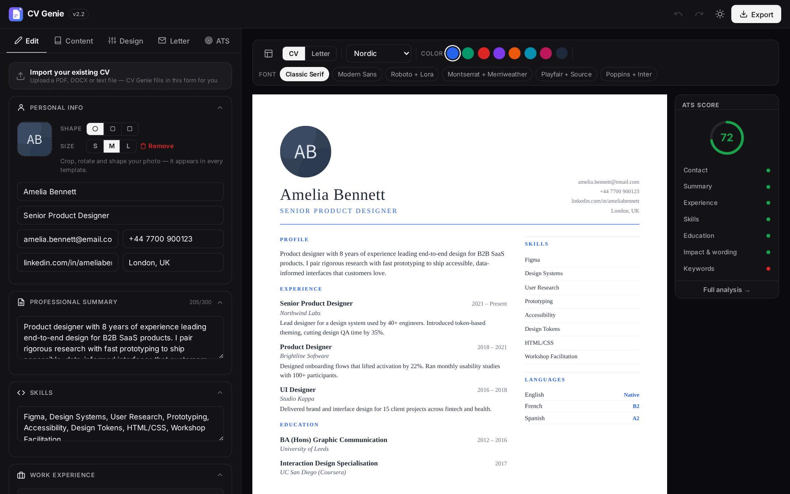 |

### Data portability

- **LinkedIn import** — upload your LinkedIn "Save to PDF" export and autofill the form (experiences, education, skills and languages).
- **Share links** — the entire CV is LZ-compressed into a URL. Anyone with the link sees your exact CV; nothing is sent to a server.
- **JSON backup** — full export/import of your state.
- **Version history** — save and restore up to 10 named snapshots.
- **Autosave** — state persists to `localStorage` every 5 minutes and when the tab is hidden.

---

## ✦ Templates

All 18 templates rendered with the same sample data:

| | | |
|:---:|:---:|:---:|
| [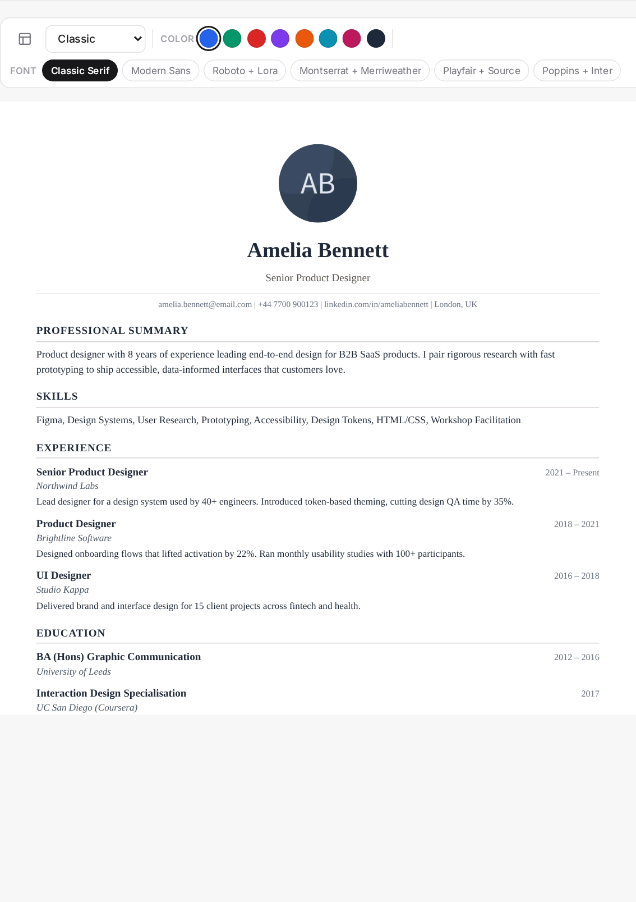](docs/images/templates/classic.png) | [](docs/images/templates/modern.png) | [](docs/images/templates/nordic.png) |
| **Classic** — traditional serif | **Modern** — colour header, two columns | **Nordic** — Scandinavian minimalism |
| [](docs/images/templates/minimal.png) | [](docs/images/templates/swiss.png) | [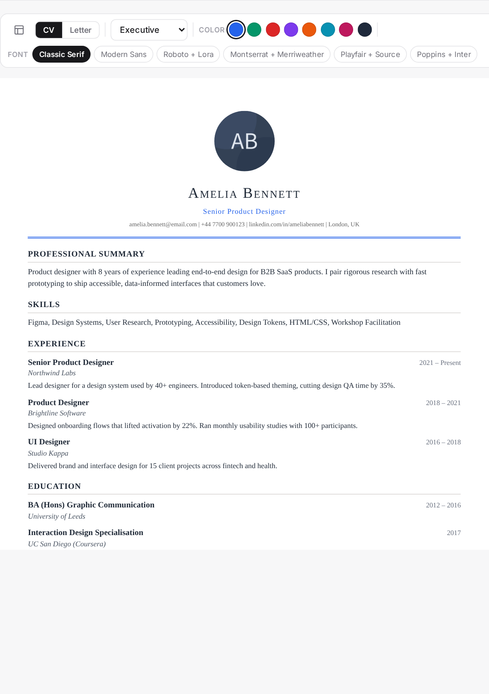](docs/images/templates/executive.png) |
| **Minimal** — light and elegant | **Swiss** — typographic grid | **Executive** — boardroom small-caps |
| [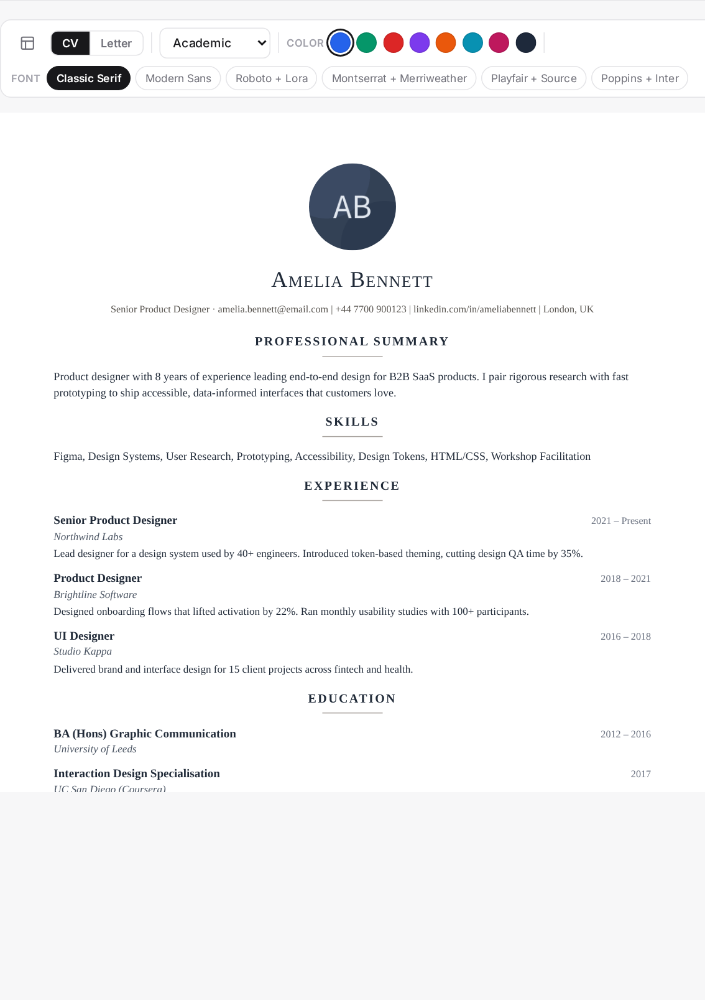](docs/images/templates/academic.png) | [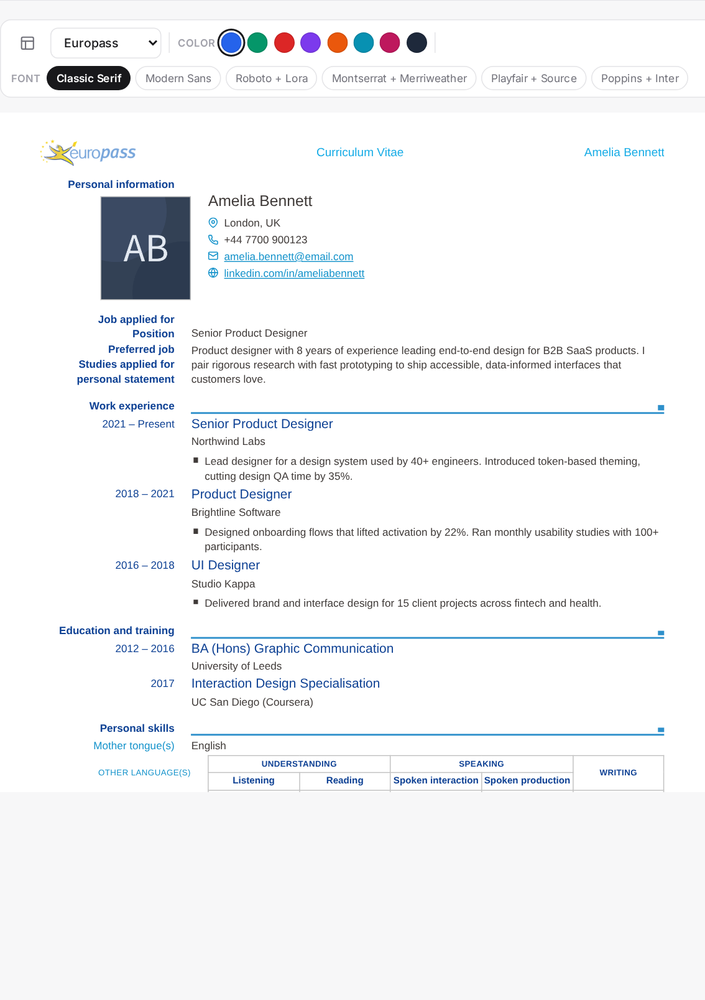](docs/images/templates/europass.png) | [](docs/images/templates/compact.png) |
| **Academic** — conservative, centred | **Europass** — EU format with CEFR grid | **Compact** — dense one-pager |
| [](docs/images/templates/sidebar-bold.png) | [](docs/images/templates/timeline.png) | [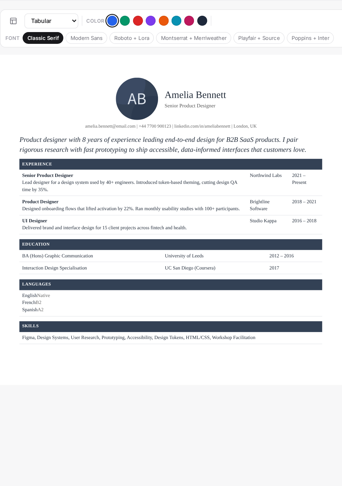](docs/images/templates/tabular.png) |
| **Sidebar Bold** — full-colour sidebar | **Timeline** — visual career timeline | **Tabular** — structured tables |
| [](docs/images/templates/newspaper.png) | [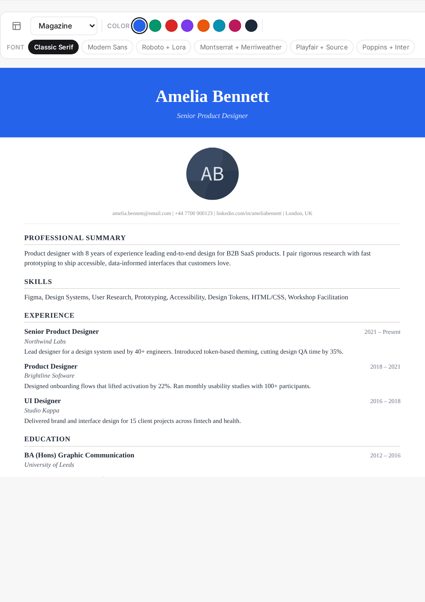](docs/images/templates/magazine.png) | [](docs/images/templates/infographic.png) |
| **Newspaper** — two-column density | **Magazine** — editorial masthead | **Infographic** — data cards |
| [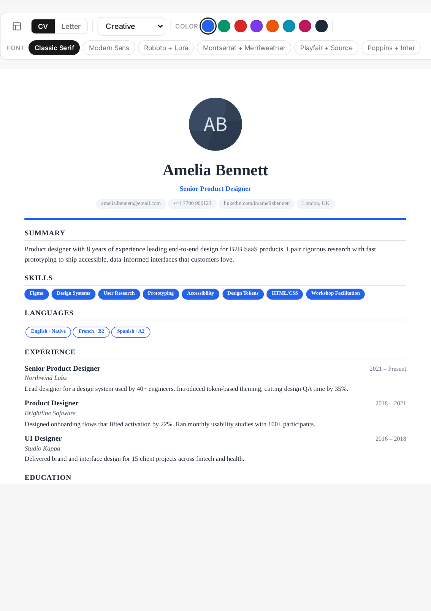](docs/images/templates/creative.png) | [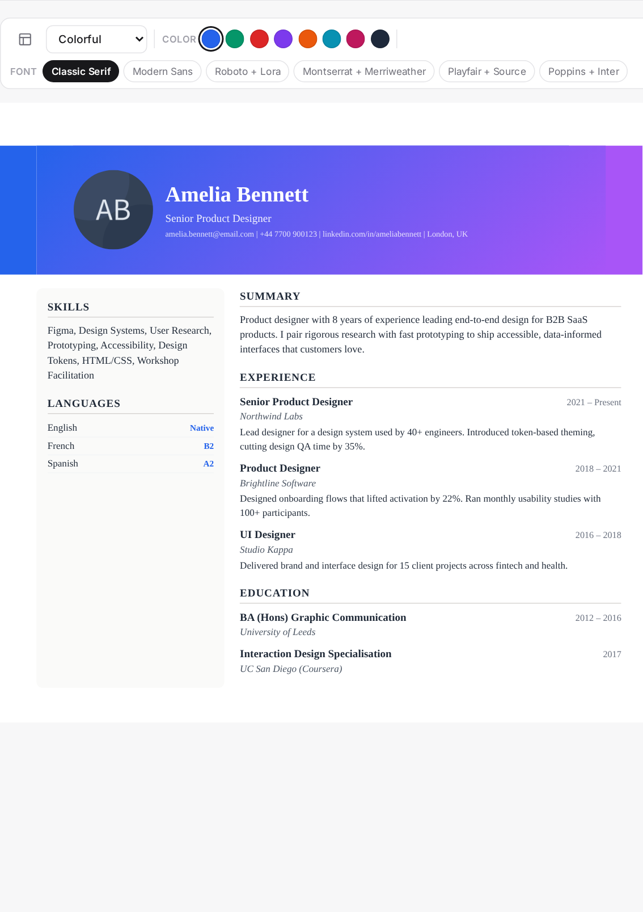](docs/images/templates/colorful.png) | [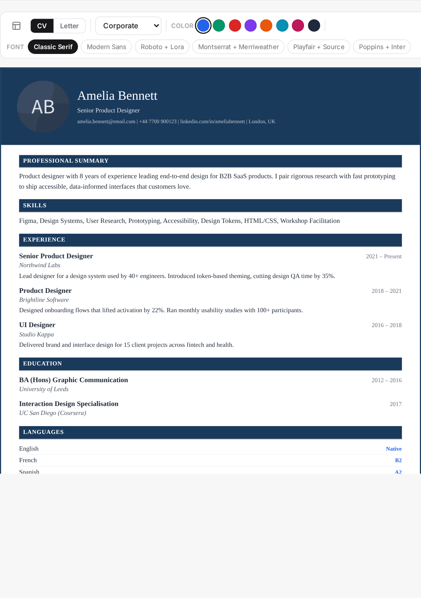](docs/images/templates/corporate.png) |
| **Creative** — tag-based skills | **Colorful** — bold gradient | **Corporate** — navy frame |

### About the Europass template

The [Europass CV](https://europa.eu/europass/en) is the European Union's standard CV format. CV Genie's Europass template is a faithful reproduction of the [official European Commission template](https://www.eeas.europa.eu/sites/default/files/standard_cv.docx) — structure, colours and typography were extracted directly from the official DOCX:

- **Header**: the official Europass logo, "Curriculum Vitae" and the candidate name in light blue, exactly like the original first-page header.
- **Personal information**: the name in the content column with contact lines (address, telephone, e-mail, website) and small blue pictograms; the profile photo sits in the label gutter, as in the official layout.
- **Job applied for; position; preferred job; studies applied for; personal statement** — the official stacked label block, filled with your job title and professional summary.
- **Work experience / Education and training** entries with dates right-aligned in the label gutter, position and qualification headings in navy, employers/institutions and square-bulleted activities in the content column.
- **Personal skills** with *Mother tongue(s)*, the official CEFR self-assessment grid (Understanding → Listening / Reading, Speaking → Spoken interaction / Spoken production, Writing) and its levels legend, plus *Job-related skills*.
- Official styling tokens: Arial, navy `#0E4194` caps headings with the `#2E90CB` rules, `#1593CB` field labels, `#C0C0C0` grid borders, and the "© European Union" footer.

| Understanding | | Speaking | | Writing |
|---|---|---|---|---|
| Listening | Reading | Spoken interaction | Spoken production | |
| B2 | B2 | B2 | B2 | B2 |

Add languages in the **Languages** section of the Edit tab, choosing *Native* for your mother tongue(s) or a CEFR level (A1–C2) for others. The grid fills each skill column with the chosen level — edit the source if you need per-skill levels.

---

## ✦ Documentation

### Getting started

No build step. Either open `index.html` directly, or serve the folder (recommended, so the service worker and CDN fonts behave consistently):

```bash
# any static server works
python3 -m http.server 8080
# or
npx serve .
```

Then open http://localhost:8080. To publish your own copy, push to a GitHub repo and enable GitHub Pages — the included [deploy workflow](.github/workflows/deploy.yml) handles it automatically.

### Architecture

The application is a single, self-contained HTML file (SPA) — vanilla JavaScript, CSS and carefully chosen libraries loaded from CDN. There is no framework and no build step.

**Frontend libraries**

| Library | Purpose |
|---|---|
| html2pdf.js / html2canvas | Client-side PDF and PNG rendering |
| SortableJS | Drag-and-drop reordering (sections and list items) |
| JSZip + FileSaver.js | Bulk ZIP export of all templates |
| pdf.js | Text extraction from LinkedIn PDF uploads |
| Cropper.js | In-browser photo cropping and rotation |
| LZ-String | Compressing CV state into shareable URLs |

**Optional export microservice** — a companion Node.js server (`/export-pdf`, `/export-docx`) renders high-quality files with headless Chrome and the `docx` library. The client falls back to browser-based exports when it is unavailable. See [API endpoints](#api-endpoints-server-side) for the contract.

**Project structure**

```
.
├── index.html                  # the entire app (UI + CSS + JS)
├── docs/images/                # screenshots used by this README
│   └── templates/*.png         # all 18 template previews
├── scripts/
│   └── validate.js             # CI validation (structure, JS syntax, registry, assets)
└── .github/workflows/
    ├── ci.yml                  # validation on push/PR
    ├── deploy.yml              # GitHub Pages deployment
    └── release.yml             # tagged releases with packaged artifact
```

### Smart tabs

| Tab | Contents |
|---|---|
| **Edit** | Personal info (photo, contact), Summary, Skills, Experience, Education, Languages — all collapsible and reorderable |
| **Content** | 20 summary templates · skill cloud (10 categories) |
| **Design** | Font pairing (6) · accent colour (8 presets) |
| **ATS** | Score ring, section checklist, target role, custom keywords, keyword cloud |
| **Tools** | LinkedIn import · JSON backup · share link · version history |

### State management & undo/redo

The whole CV is serialised by `getState()` into one plain object (template, colour, font pair, photo settings, section order, fields, experiences, education, languages, ATS keywords). Undo/redo stacks keep up to 50 snapshots; `restoreState()` rebuilds the form and preview from any snapshot. The same object powers share links, JSON backup, version history and autosave (`localStorage`, key `cvGenie_v2.0`, with migration from the v1 key).

### API endpoints (server-side)

`POST /export-pdf`

```json
{
  "html": "<div class=\"cv-preview cv-modern\">…</div>",
  "color": "#2563eb",
  "fontHeading": "Georgia, serif",
  "fontBody": "Georgia, serif"
}
```

Response: `application/pdf` binary.

`POST /export-docx`

```json
{
  "name": "John Doe",
  "title": "Software Engineer",
  "contact": "john@example.com | …",
  "summary": "…",
  "skills": "…",
  "experiences": [{ "title": "…", "company": "…", "dates": "…", "description": "…" }],
  "education": [{ "degree": "…", "institution": "…", "year": "…" }],
  "languages": [{ "language": "English", "level": "Native" }]
}
```

Response: `application/vnd.openxmlformats-officedocument.wordprocessingml.document` binary.

Both endpoints should handle CORS and return `{ "error": "message" }` JSON on failure.

### Keyboard shortcuts & accessibility

- `Ctrl/Cmd+Z` — undo · `Ctrl/Cmd+Y` — redo (outside text fields)
- `Ctrl/Cmd+S` — suppressed (prevents the browser save dialog)
- Section headers are clickable/focusable; icon buttons carry `aria-label`s; focus-visible rings throughout; dark mode honours `prefers-color-scheme` on first visit.

### PWA

A minimal service worker (registered from a blob URL, cache `cvgenie-v2`) caches the app shell for offline use with a cache-first strategy.

## ✦ CI/CD

Three GitHub Actions workflows:

| Workflow | Trigger | What it does |
|---|---|---|
| [ci.yml](.github/workflows/ci.yml) | push to `main`, PRs | Runs `scripts/validate.js`: HTML structure, tag balance, `node --check` on every inline script, template registry consistency (TEMPLATES ↔ TEMPLATE_META ↔ THUMB_WIRES ↔ switch cases), README image references, workflow YAML parsing, file-size guard |
| [deploy.yml](.github/workflows/deploy.yml) | push to `main`, manual | Deploys the repo to GitHub Pages (upload artifact → deploy-pages). Enable "GitHub Actions" as the Pages source in repo settings |
| [release.yml](.github/workflows/release.yml) | `v*` tags | Validates, packages `index.html` into a versioned ZIP (+ SHA-256) and publishes a GitHub Release with generated notes |

## ✦ Common maintenance tasks

### Adding a new CV template

1. Add the slug to the `TEMPLATES` array (keep `TEMPLATE_META`, `THUMB_WIRES` and the switch in sync — CI checks this).
2. Add `{name, desc}` to `TEMPLATE_META` and a wireframe to `THUMB_WIRES` (tiny div-based layout sketch shown in the gallery).
3. Add a `case 'slug':` to the switch in `_updatePreviewNow()`, building HTML from the shared helpers (`esc()`, `eH`, `dH`, `langLines`, `ph`, `skillList`, `contactLines`).
4. Add any template-specific CSS under `.cv-preview.cv-slug { … }`.

### Adding a font pair

Append `{name, heading, body}` to `FONT_PAIRS` and add the families to the Google Fonts `<link>` in `<head>` so the preview and exports render them.

### Updating ATS keyword roles

Edit the `ROLE_KW` dictionary inside `runATSAnalysis()`. Target roles are matched longest-first and case-insensitively.

### Regenerating README screenshots

Serve the repo, then use Playwright against `restoreState()` with sample data and `changeTemplate(t)` — screenshot `#cvScaleOuter` per template into `docs/images/templates/`.

---

<div align="center">

**[Live demo](https://touhidsiddiqueeraj-bit.github.io/CV-Genie/)** · Built with vanilla HTML, CSS and JavaScript.

</div>
